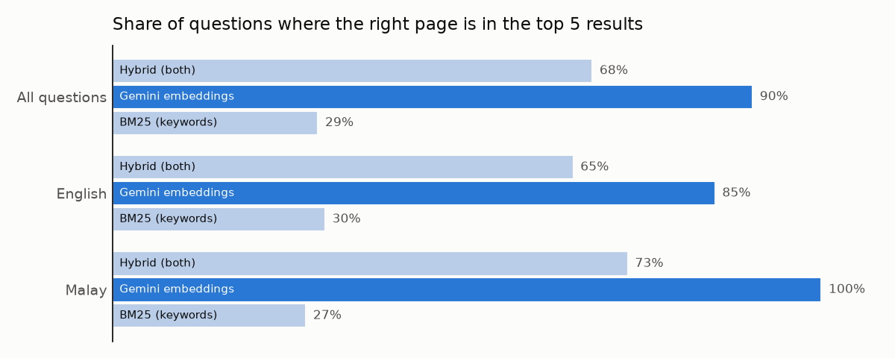

# Malaysia Economy AI Assistant Using RAG

Ask questions about Malaysia's economy, inflation and interest rates in **English or Malay**, and get a short
answer with the report page for every fact. Answers come from Bank Negara Malaysia's reports (retrieval-augmented
generation), and state-level inflation figures come from a lookup tool over OpenDOSM consumer price data.

**Live demo:** _coming soon_  
**Companion dashboard:** [Malaysia inflation in Power BI](https://app.powerbi.com/view?r=eyJrIjoiZmZjNDg2ODItNzJhMy00OTllLWJmNTYtM2Q5MDg4YWFiMGQxIiwidCI6ImNkY2JiMGUyLTlmZWEtNGY1NC04NjcwLTY3MjcwNzc5N2FkYSIsImMiOjEwfQ%3D%3D)



## Results

Tested on 41 questions written before looking at any answers: 31 about the reports (11 in Malay), 5 asking for
inflation figures by state, category and month, and 5 the reports can't answer.

| What was checked | Score |
|---|---|
| Report questions answered correctly (graded by hand against the source page) | **28 / 31 (90%)** |
| Malay report questions answered correctly | **11 / 11** |
| Inflation-figure questions: used the lookup tool and gave the right number | **5 / 5** |
| Unanswerable questions refused instead of guessed | **5 / 5** |
| Answerable questions wrongly refused | 1 / 36 |

**Finding the right page.** For each report question, every page containing a key phrase from the answer counts
as a correct page (patterns in `eval/questions.csv`), so the correct pages aren't hand-picked. Share of questions
with a correct page in the top 5 results:

| Search method | All (31) | English (20) | Malay (11) |
|---|---|---|---|
| BM25 keywords | 29% | 30% | 27% |
| **Gemini embeddings (used by the app)** | **90%** | **85%** | **100%** |
| Hybrid (both, reciprocal rank fusion) | 68% | 65% | 73% |

- **Embeddings win clearly.** Keyword search fails on Malay questions because the reports are in English, and
  on English questions in everyday words ("how much did prices rise") because the reports say "headline
  inflation".
- **Combining the two made things worse.** The hybrid gives keyword search an equal vote, and its poor
  rankings push good pages down.

## Where it goes wrong

The three wrong answers (all in `output/answers.csv`):

1. **Answering a nearby question.** Asked what inflation BNM expects in 2026, it gave the *core* inflation
   forecast (1.8–2.3%) instead of *headline* (1.5–2.5%). Both are on neighbouring pages.
2. **Refusing when the page wasn't retrieved.** Asked how much petrol and diesel prices rose when subsidies were
   cut, it said it couldn't find this. The page with the answer wasn't in the top 5, and the model correctly
   refused rather than guess.
3. **A true but incomplete answer.** Asked what was special about investment in 2024, it described growth
   correctly but missed the key point: the highest investment growth in a decade.

Only 61% of answers cite a page that contains the exact key phrase, even though 90% are correct. Most of the
gap is pages that state the same fact in other words (for example, a summary page with "8.7%" in a table).

**What would help most:** more passages per question (8 instead of 5) and a reranking step, at the cost of
more free-tier usage.

## How it works

| Step | File | What it does |
|---|---|---|
| 1 | `reports.py` | Downloads 33 documents listed in `sources.csv` (Economic and Monetary Reviews 2022–2025 and 29 Monetary Policy Statements), checks each against its SHA-256 hash, and splits pages into 400-word passages with 60 words of overlap. Passages never cross a page, so every citation is a single page. |
| 2 | `index.py` | Embeds the 800 passages with Gemini (`gemini-embedding-001`, 768 dimensions) and saves only passage ids and vectors to `index/`. |
| 3 | `retrieve.py` | BM25, embedding and hybrid search. The app uses embeddings and falls back to keywords if Gemini is unavailable. |
| 4 | `cpi.py` | `cpi_lookup(state, category, month)`: inflation by state (English or Malay names) and category from OpenDOSM, January 2010 to September 2026. |
| 5 | `llm.py` | Gemini Flash-Lite answers from the numbered passages, may call `cpi_lookup`, and must cite every fact or reply that it couldn't find the answer. |
| 6 | `evaluate.py` | Search scores, the 41-question run, and the summary of hand grades. |
| 7 | `app.py` | The Streamlit chat app. |

**Why Bank Negara's text isn't in this repo.** Bank Negara's website terms reserve copyright, so the repo holds
only links, hashes, passage ids and vectors. The app downloads the reports from bnm.gov.my on first start and
rebuilds the passages; the hashes make sure they match the saved vectors, and the app says so if a document
has changed.

**Free-tier limits.** Gemini's free plan allows about 1,000 embeddings and about 500 Flash-Lite answers a day.
Indexing used most of a day's embeddings, so `index.py` saves progress and continues the next day if stopped.
Each question uses one embedding and one answer. When a daily limit runs out, the app tries other Flash models
and then shows the most relevant pages without an AI answer.

## Run it

Uses Python 3.14 and a free Gemini API key from [Google AI Studio](https://aistudio.google.com/apikey).

```bash
python -m venv .venv
.venv\Scripts\activate
pip install -r requirements.txt
```

Put the key in `.streamlit/secrets.toml` (kept out of git):

```toml
GEMINI_API_KEY = "your-key"
```

Then:

```bash
streamlit run app.py
```

The search index is already in the repo. To rebuild it or the results: `python index.py`,
`python evaluate.py retrieval`, `python evaluate.py answers`, then fill the `correct` column in
`output/answers.csv` and run `python evaluate.py summary`. Tests: `pip install -r requirements-dev.txt` and
`pytest`.

## Data

- **Source: Bank Negara Malaysia.** Economic and Monetary Review 2022–2025 and Monetary Policy Statements
  (January 2022 to September 2026), downloaded from [bnm.gov.my](https://www.bnm.gov.my). Not redistributed here.
- **OpenDOSM** consumer price index by state and division, [data.gov.my](https://data.gov.my) (CC BY 4.0),
  up to September 2026. Questions about later months get the latest available month, with a note.
